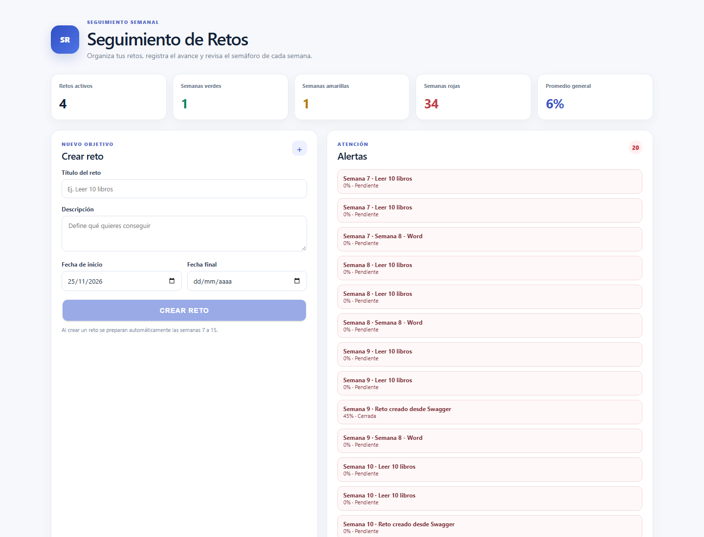
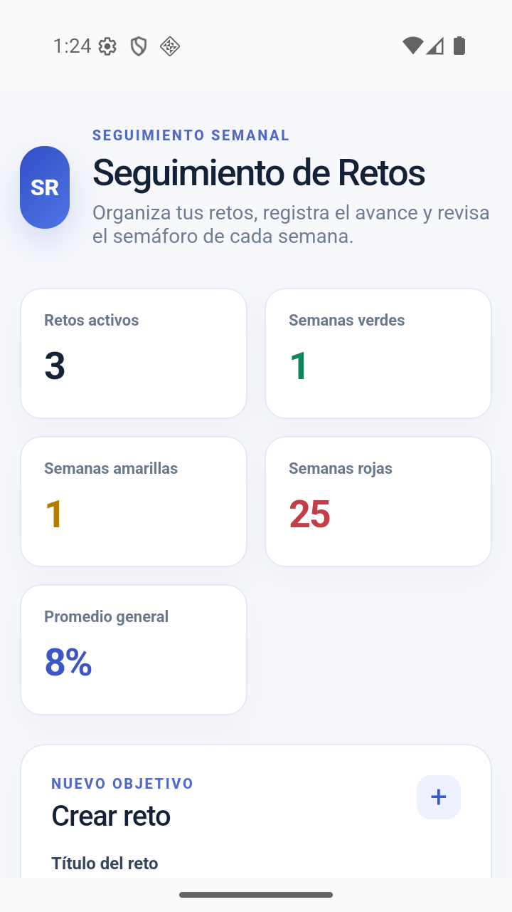
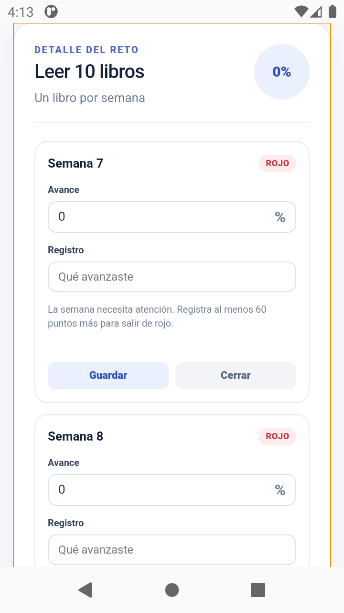

# Entrega parcial B1 Seguimiento de Retos

## Descripción del trabajo

La aplicación permite crear retos y llevar un control semanal del avance. Cada reto genera las semanas 7 a 15. En cada semana se registra un porcentaje y una nota sobre el trabajo realizado. El color del semáforo se calcula con el porcentaje: verde desde 80 %, amarillo desde 60 % y rojo por debajo de 60 %.

La aplicación está formada por un backend Django conectado a MySQL, una interfaz web hecha con Angular e Ionic, y una versión Android generada con Capacitor.

## Funcionalidad propia desarrollada

Agregué un panel de seguimiento y recomendaciones. Este panel resume los retos activos, las semanas por color y el promedio general. Además, en cada semana aparece una recomendación según el avance actual. Cuando una semana queda cerrada, el backend rechaza cualquier intento de cambiarla y la app muestra un aviso si se cerró en rojo.

Esta funcionalidad aporta una guía práctica para continuar el reto. No se limita a guardar el porcentaje, también indica cuánto falta para mejorar la semana.

## Cambios realizados

### Backend

- Se creó el modelo `TareaSemanal` con las semanas 7 a 15.
- Cada reto nuevo crea sus nueve semanas automáticamente.
- Se agregaron las rutas `api/tareas/` y `api/alertas/`.
- Se agregó la acción para cerrar una semana y bloquear sus cambios.
- Se agregaron pruebas para la creación de semanas y el bloqueo de semanas cerradas.

### Frontend y Android

- Se rediseñó la interfaz para mostrar el resumen, alertas y detalle semanal.
- Se agregó la búsqueda por título o descripción.
- La dirección de la API cambia automáticamente a `10.0.2.2` cuando se ejecuta en Android.
- Se habilitó el tráfico HTTP local y CORS para que Capacitor pueda consumir Django desde el emulador.

## Evidencias

### Evidencia web

La aplicación web funciona en `http://127.0.0.1:8100/` y consulta la API local de Django. La captura muestra el panel de seguimiento, el formulario de creación y las alertas de semanas en rojo.

### Evidencia Android

La siguiente captura muestra la aplicación instalada en el emulador. Presenta tres retos, una semana verde, una amarilla y las semanas en rojo que aparecen en el panel de resumen.

La versión de entrega también se probó en un Nexus 5 virtual con Android 11. Al pulsar una alerta se abre el detalle del reto, donde aparecen sus semanas y las recomendaciones.

### Evidencia de la APK

La compilación terminó con `BUILD SUCCESSFUL`. La APK se generó en `frontend/android/app/build/outputs/apk/debug/app-debug.apk` y la versión de entrega se instaló en el emulador `Seguimiento_Basico`.

### Evidencia de pruebas

Se ejecutaron las siguientes verificaciones:

| Comando | Resultado |
| --- | --- |
| `python manage.py check --database default` | Sin errores. |
| `python manage.py test retos -v 2` | 5 pruebas ejecutadas correctamente. |
| `npm run build` | Compilación terminada con avisos de compatibilidad y tamaño. |
| `npm test -- --watch=false` | 2 pruebas aprobadas. |
| `gradlew.bat assembleDebug` | APK generada correctamente. |

También se probó una semana con 92 % para el color verde, otra con 68 % para amarillo y una con 45 % para rojo. Después de cerrar la semana roja, el API respondió HTTP 400 cuando se intentó modificarla otra vez.

## Dificultades y solución

La principal dificultad fue la comunicación entre la app Android y Django. Al principio Android bloqueó la llamada porque la WebView estaba cargada por HTTPS y el backend local usa HTTP. Se configuró Capacitor para usar el esquema HTTP en Android y se habilitó el tráfico local en el manifiesto.

Luego la web abierta en `127.0.0.1:8100` mostró un error de CORS porque solo estaba autorizado `localhost:8100`. Se añadió también `http://127.0.0.1:8100` al archivo local de configuración. Con eso la web y Android pudieron consumir la misma API.
